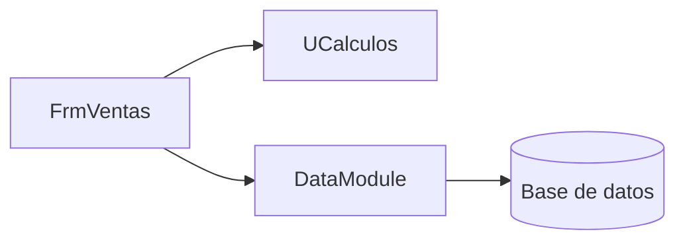
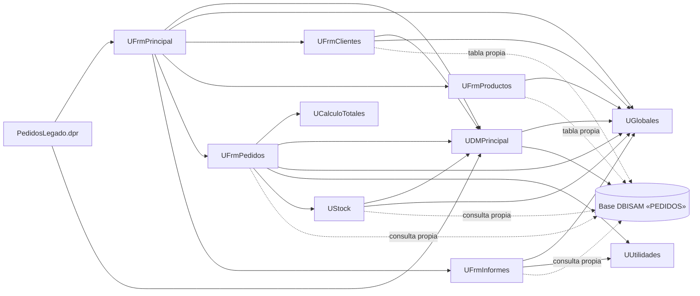

# Dependencias de Pedidos Legado

<!--
Etapa 1 · Entender (plan mode).
Dibuja quién usa a quién: unidades, formularios y la base de datos.
- Una flecha A --> B significa «A usa a B» (lo ves en la cláusula uses o en una consulta SQL).
- Incluye la base de datos (DBISAM) como un nodo: es parte del sistema.
Punto de control E1: el diagrama incluye la base de datos.

Ejemplo genérico (de otro sistema, no de este):

-->

Flecha continua: `uses` en el código. Flecha punteada: el módulo abre su propio componente DBISAM (`DatabaseName = 'PEDIDOS'`) o arma su propio SQL, sin pasar por el data module.

### Qué tablas toca cada módulo

| Módulo | Tablas | Evidencia |
|---|---|---|
| UDMPrincipal | CLIENTES, PRODUCTOS, PEDIDOS, PEDIDO_LINEAS, PARAMETROS | `UDMPrincipal.dfm:19-49`, `UDMPrincipal.pas:85` |
| UFrmPedidos | CLIENTES, REGIONES, PRODUCTOS, PEDIDOS, PEDIDO_LINEAS | `UFrmPedidos.pas:101`, `:152`, `:249-287`, `:320` |
| UFrmClientes | CLIENTES, PEDIDOS | `UFrmClientes.dfm:204`, `UFrmClientes.pas:76`, `:160`, `:207` |
| UFrmProductos | PRODUCTOS | `UFrmProductos.dfm:89` |
| UFrmInformes | PEDIDOS, CLIENTES | `UFrmInformes.pas:66` |
| UStock | PRODUCTOS, PEDIDO_LINEAS, MOV_STOCK (no está en el esquema) | `UStock.pas:23`, `:51`, `:64`, `:85` |

## Preguntas guía

1. ¿Qué unidad usan casi todas las demás? ¿Qué pasaría si cambia?
   **UGlobales**: la usan 7 de las 9 unidades restantes (todas excepto UCalculoTotales y UUtilidades). Son variables globales que modifican varios formularios (tasa de IVA, nivel de usuario, flete base), así que un cambio, o un valor mal cargado, afecta a pedidos, stock, clientes, productos e informes al mismo tiempo, y es difícil saber quién lo cambió. Le sigue UDMPrincipal (4 unidades).
2. ¿Qué unidad no depende de formularios ni de la base de datos? ¿Por qué eso importa para migrar?
   **UGlobales** no usa ninguna unidad, y **UCalculoTotales** y **UUtilidades** solo usan la RTL de Delphi (`SysUtils`, `DateUtils`). Son lógica pura: se pueden pasar a C# en `PedidosWeb.Core` con tests xUnit sin arrastrar ni la UI ni DBISAM, por lo que son las primeras candidatas a migrar. Ojo: UFrmPedidos no usa todas las reglas de UCalculoTotales y recalcula el total por su cuenta, así que hay que decidir cuál es la regla «verdadera».
