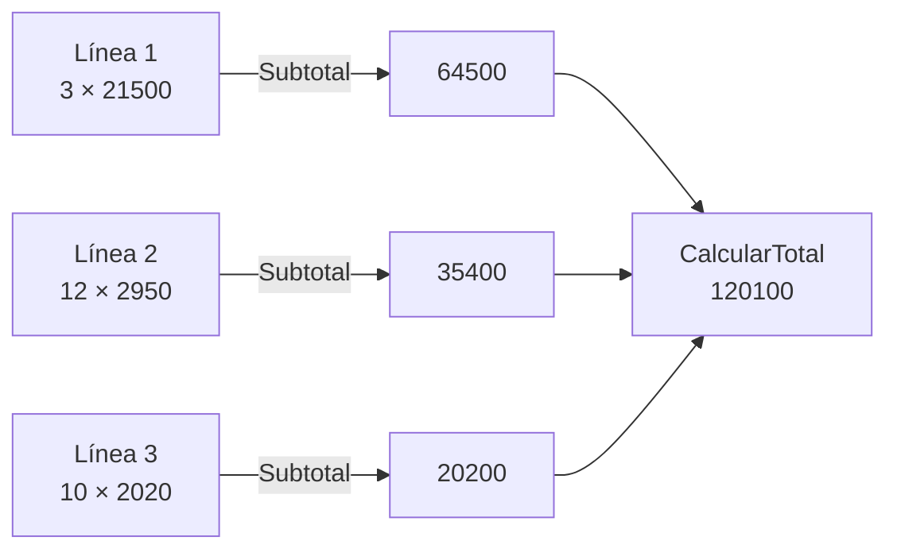

# CalculadoraTotalPedido

> Módulo: `src/PedidosWeb.Core/Pedidos/` · Tests: `tests/PedidosWeb.Core.Tests/Pedidos/CalculadoraTotalPedidoTests.cs` · Historia: HU-02 (incremento 1)

## Propósito

Calcula los montos de un pedido a partir de sus líneas (`LineaPedido`).

Los montos son pesos chilenos (CLP), en `decimal` y sin decimales, y **sin IVA**. El IVA, los descuentos y los recargos llegan en la Unidad 5.

Es una clase estática, sin estado. `DetallePedidoServicio` la usa para armar el detalle del pedido.

Una `LineaPedido` tiene `PedidoId`, `Numero`, `Producto`, `Cantidad` (`int`) y `PrecioUnitario` (`decimal`).

## API pública

### `static decimal Subtotal(LineaPedido linea)`

Devuelve `Cantidad × PrecioUnitario` de la línea.

### `static decimal CalcularTotal(IEnumerable<LineaPedido> lineas)`

Devuelve la suma de los `Subtotal` de las líneas. Si no hay líneas, devuelve `0`.

## Ejemplo de uso

Pedido 8, con datos tomados de `CalculadoraTotalPedidoTests`:

```csharp
var lineas = new LineaPedidoRepositorioEnMemoria().ObtenerPorPedido(8);
// 1. Harina para pan 25 kg   3 × 21500
// 2. Mantequilla 250 g      12 ×  2950
// 3. Bebida cola 1,5 L      10 ×  2020

CalculadoraTotalPedido.Subtotal(lineas[0]);      // 64500
CalculadoraTotalPedido.Subtotal(lineas[1]);      // 35400
CalculadoraTotalPedido.Subtotal(lineas[2]);      // 20200
CalculadoraTotalPedido.CalcularTotal(lineas);    // 120100
```

## Diagrama Mermaid


