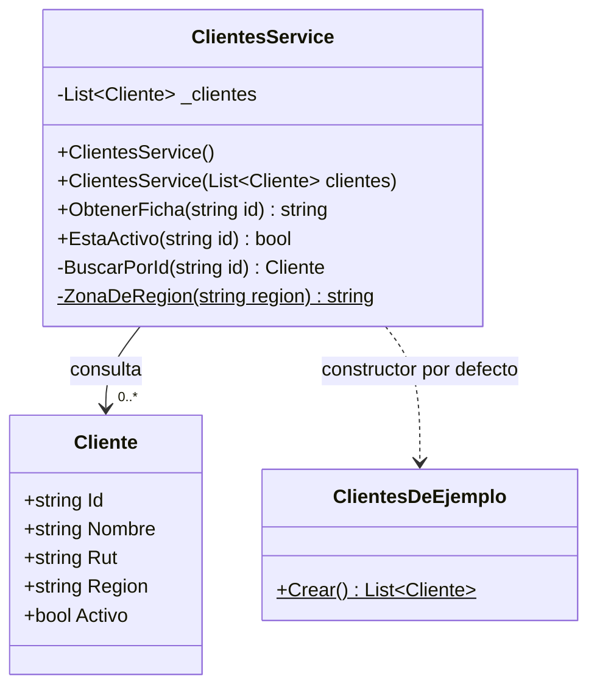
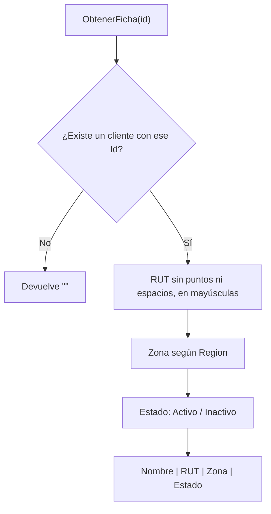

# ClientesService

> Módulo: `src/PedidosWeb.Core/Clientes/` · Tests: `tests/PedidosWeb.Core.Tests/Clientes/ClientesServiceTests.cs`

## Propósito

Consulta los clientes de la distribuidora para dos usos:

- Armar la **ficha** que se muestra en pantalla.
- Saber si un cliente **está activo**.

Trabaja sobre una lista de `Cliente` en memoria. Por defecto usa los 8 clientes de `ClientesDeEjemplo` (`C-001` a `C-008`, datos ficticios).

Un `Cliente` tiene `Id`, `Nombre`, `Rut`, `Region` y `Activo`. El `Rut` viene escrito como en el sistema legado: a veces con puntos, con espacios o con la «k» en minúscula.

## API pública

### Constructores

| Firma | Qué hace |
|---|---|
| `ClientesService()` | Usa los clientes de `ClientesDeEjemplo.Crear()`. |
| `ClientesService(List<Cliente> clientes)` | Usa la lista que recibe. |

### `string ObtenerFicha(string id)`

Devuelve la ficha del cliente con ese `id` en el formato `Nombre | RUT | Zona | Estado`.

- **Cliente inexistente:** devuelve `""` (texto vacío).
- **Búsqueda:** compara el `Id` exacto, distinguiendo mayúsculas, y usa el primer cliente que coincide.
- **RUT:** quita los puntos y los espacios y lo pasa a mayúsculas. Ejemplo: `76.990.011-k` queda como `76990011-K`.
- **Zona, según `Region`:**

  | Region | Zona |
  |---|---|
  | `RM`, `V` | Zona centro |
  | `VIII` | Zona sur |
  | `II` | Zona norte |
  | cualquier otra | Sin zona |

- **Estado:** `Activo` o `Inactivo`.

### `bool EstaActivo(string id)`

Devuelve `true` solo si el cliente existe y está activo. Devuelve `false` si está inactivo o si no existe.

## Ejemplo de uso

Con los clientes de ejemplo (casos tomados de `ClientesServiceTests`):

```csharp
var servicio = new ClientesService();

servicio.ObtenerFicha("C-001"); // "Ferretería El Clavo | 76123456-0 | Zona centro | Activo"
servicio.ObtenerFicha("C-004"); // "Almacén La Esquina | 76990011-K | Zona centro | Activo"
servicio.ObtenerFicha("C-999"); // ""

servicio.EstaActivo("C-001");   // true
servicio.EstaActivo("C-007");   // false (Kiosco Central está inactivo)
servicio.EstaActivo("C-999");   // false (no existe)
```

## Diagrama Mermaid




