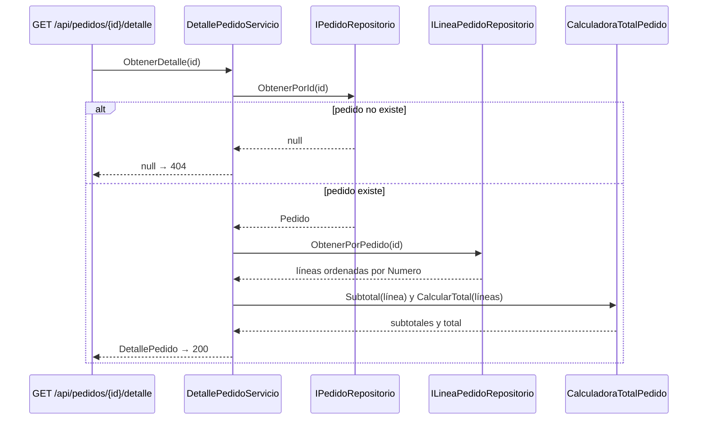

# DetallePedidoServicio

> Módulo: `src/PedidosWeb.Core/Pedidos/` · Tests: `tests/PedidosWeb.Core.Tests/Pedidos/DetallePedidoServicioTests.cs` · Historia: HU-02 (`specs/HU-02-detalle-pedido/spec.md`)

## Propósito

Arma el **detalle de un pedido**: los datos del pedido, el cliente, las líneas con su subtotal y el total. Sirve para que un vendedor le responda al cliente sin entrar al sistema legado.

El total se calcula desde las líneas con `CalculadoraTotalPedido`, no desde `Pedido.Total`. Los montos están en CLP, son `decimal` y no incluyen IVA.

La API lo expone en `GET /api/pedidos/{id}/detalle` (`src/PedidosWeb.Api/Program.cs`): responde `200` con el detalle o `404` si el pedido no existe.

## API pública

### Constructor

`DetallePedidoServicio(IPedidoRepositorio pedidos, ILineaPedidoRepositorio lineas)`: recibe de dónde leer los pedidos y sus líneas. Hoy son los repositorios en memoria.

### `DetallePedido? ObtenerDetalle(int id)`

- **Pedido inexistente:** devuelve `null`.
- **Pedido existente:** devuelve un `DetallePedido` con:

| Campo | Origen |
|---|---|
| `Id`, `Folio`, `Fecha` (`DateOnly`), `Estado`, `Sucursal` | El `Pedido` |
| `ClienteId`, `ClienteNombre` | El `Pedido` |
| `Lineas` (`IReadOnlyList<LineaDetalle>`) | Las líneas del pedido, ordenadas por `Numero` |
| `Total` | `CalculadoraTotalPedido.CalcularTotal(lineas)` |

Cada `LineaDetalle` tiene `Numero`, `Producto`, `Cantidad`, `PrecioUnitario` y `Subtotal`, donde `Subtotal` es `Cantidad × PrecioUnitario`.

## Ejemplo de uso

Con los datos de ejemplo, igual que en `DetallePedidoServicioTests`:

```csharp
var servicio = new DetallePedidoServicio(
    new PedidoRepositorioEnMemoria(), new LineaPedidoRepositorioEnMemoria());

var detalle = servicio.ObtenerDetalle(8);
// detalle.Folio         → "PED-STGO-000008"
// detalle.Estado        → "Entregado"
// detalle.ClienteId     → "C-001"
// detalle.ClienteNombre → "Ferretería El Clavo"
// detalle.Lineas        → números 1, 2, 3
// detalle.Total         → 120100 (= suma de los subtotales)

servicio.ObtenerDetalle(999); // null  → la API responde 404
```

Respuesta de `GET /api/pedidos/8/detalle`:

```json
{
  "id": 8, "folio": "PED-STGO-000008", "fecha": "2026-10-20", "estado": "Entregado", "sucursal": "STGO",
  "clienteId": "C-001", "clienteNombre": "Ferretería El Clavo",
  "lineas": [
    { "numero": 1, "producto": "Harina para pan 25 kg", "cantidad": 3, "precioUnitario": 21500, "subtotal": 64500 },
    { "numero": 2, "producto": "Mantequilla 250 g", "cantidad": 12, "precioUnitario": 2950, "subtotal": 35400 },
    { "numero": 3, "producto": "Bebida cola 1,5 L", "cantidad": 10, "precioUnitario": 2020, "subtotal": 20200 }
  ],
  "total": 120100
}
```

## Diagrama Mermaid


