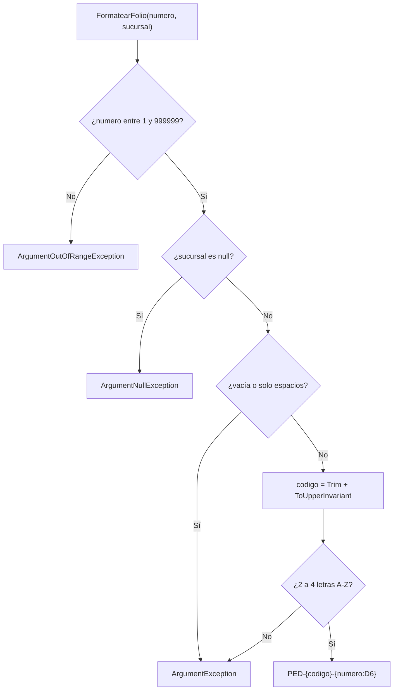

# FolioFormatter

> Módulo: `src/PedidosWeb.Core/Folios/` · Tests: `tests/PedidosWeb.Core.Tests/Folios/FolioFormatterTests.cs`

## Propósito

Genera el **folio** de un pedido con el mismo formato que usa el sistema legado: `PED-{SUCURSAL}-{NUMERO}`, por ejemplo `PED-STGO-000123`.

Es una clase estática, sin estado. Si recibe un dato inválido, lanza una excepción.

## API pública

### `static string FormatearFolio(int numero, string sucursal)`

Devuelve `PED-{codigo}-{numero}`. El número va con 6 dígitos, rellenado con ceros a la izquierda.

Las validaciones se aplican en este orden:

| Orden | Regla | Si no se cumple |
|---|---|---|
| 1 | `numero` entre 1 y 999999 (ambos incluidos) | `ArgumentOutOfRangeException` |
| 2 | `sucursal` no es `null` | `ArgumentNullException` |
| 3 | `sucursal` no está vacía ni tiene solo espacios | `ArgumentException` |
| 4 | Se normaliza: `Trim()` y `ToUpperInvariant()` | — |
| 5 | El código tiene de 2 a 4 letras de la `A` a la `Z` (sin `Ñ`, tildes ni dígitos) | `ArgumentException` |

- **Número primero:** si el número y la sucursal son inválidos a la vez, gana `ArgumentOutOfRangeException`.
- **Normalización:** `" stgo "` se trata como `STGO`.

## Ejemplo de uso

Casos tomados de `FolioFormatterTests`:

```csharp
FolioFormatter.FormatearFolio(123, "STGO");     // "PED-STGO-000123"
FolioFormatter.FormatearFolio(1, "VAL");        // "PED-VAL-000001"
FolioFormatter.FormatearFolio(999999, "CO");    // "PED-CO-999999"
FolioFormatter.FormatearFolio(45, " stgo ");    // "PED-STGO-000045"

FolioFormatter.FormatearFolio(0, "STGO");       // ArgumentOutOfRangeException
FolioFormatter.FormatearFolio(1000000, "STGO"); // ArgumentOutOfRangeException
FolioFormatter.FormatearFolio(7, null!);        // ArgumentNullException
FolioFormatter.FormatearFolio(7, "   ");        // ArgumentException
FolioFormatter.FormatearFolio(7, "SANTI");      // ArgumentException (5 letras)
FolioFormatter.FormatearFolio(7, "ÑUÑO");       // ArgumentException (Ñ no está entre A y Z)
FolioFormatter.FormatearFolio(7, "ST1");        // ArgumentException (tiene un dígito)
FolioFormatter.FormatearFolio(0, "S");          // ArgumentOutOfRangeException (valida primero el número)
```

## Diagrama Mermaid


