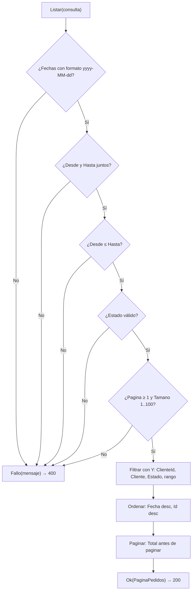

# ListadoPedidos

> Módulo: `src/PedidosWeb.Core/Pedidos/` · Tests: `tests/PedidosWeb.Core.Tests/Pedidos/ListadoPedidosTests.cs` · Historia: HU-01 (`specs/HU-01-listar-pedidos/spec.md`)

## Propósito

Lista los pedidos filtrando por cliente, estado y rango de fechas, con paginación.

Primero valida la consulta. Si es válida, devuelve una página de pedidos; si no, devuelve un mensaje de error.

La API lo expone en `GET /api/pedidos` (`src/PedidosWeb.Api/Program.cs`):

- **Consulta válida:** responde `200` con la página.
- **Consulta inválida:** responde `400` con un ProblemDetails, de título `"Filtros inválidos"` y con el error en `detail`.

## API pública

### Constructor y constantes

- **Constructor:** `ListadoPedidos(IPedidoRepositorio repositorio)` recibe de dónde leer los pedidos.
- **Constantes:**
  - `TamanoPorDefecto = 20`
  - `TamanoMaximo = 100`
  - `FormatoFecha = "yyyy-MM-dd"`
  - `EstadosValidos`: `Pendiente`, `Confirmado`, `Despachado`, `Entregado`, `Anulado`

### `ResultadoListado Listar(ConsultaPedidos consulta)`

`ConsultaPedidos` tiene todos sus campos opcionales (`null` = sin filtro):

| Campo | Tipo | Cómo filtra |
|---|---|---|
| `ClienteId` | `string?` | Código exacto, distingue mayúsculas |
| `Cliente` | `string?` | Parte del nombre; ignora mayúsculas, pero **no** tildes (`"dona"` no encuentra "Doña") |
| `Estado` | `string?` | Uno de `EstadosValidos`, sin distinguir mayúsculas |
| `Desde`, `Hasta` | `string?` | Fechas `yyyy-MM-dd`; el rango incluye los extremos |
| `Pagina` | `int?` | Desde 1. Por defecto 1 |
| `Tamano` | `int?` | De 1 a 100. Por defecto 20 |

Los filtros se combinan con **Y**.

**Validaciones**, en este orden. La primera que falla devuelve `ResultadoListado.Fallo(mensaje)`:

1. `Desde` y `Hasta` deben tener el formato `yyyy-MM-dd` y ser fechas reales (`2026-13-01` falla).
2. `Desde` y `Hasta` van juntos: si llega solo uno, falla.
3. `Desde` no puede ser mayor que `Hasta`.
4. `Estado` debe estar en `EstadosValidos`. `"Cancelado"` falla.
5. `Pagina` debe ser 1 o más, y `Tamano` debe estar entre 1 y 100.

**Si la consulta es válida,** devuelve `ResultadoListado.Ok(PaginaPedidos)`:

- **`PaginaPedidos`** tiene `Pagina`, `Tamano`, `Total` y `Pedidos`. `Total` cuenta los pedidos filtrados antes de paginar.
- **Orden:** fecha descendente y, a igual fecha, `Id` descendente.
- **Sin coincidencias** o **página después de la última:** la lista viene vacía. No es un error.

`ResultadoListado` expone `Pagina` (o `null`), `Error` (o `null`) y `EsValido`, que es `true` cuando `Error` es `null`.

## Ejemplo de uso

Con los 45 pedidos de ejemplo. Los casos salen de `ListadoPedidosTests`:

```csharp
var listado = new ListadoPedidos(new PedidoRepositorioEnMemoria());

listado.Listar(new ConsultaPedidos());
// Válido · Total 45 · Página 1 de tamaño 20 · primer Id 21, último Id 18

listado.Listar(new ConsultaPedidos(ClienteId: "C-001"));
// Ids 8, 16, 24, 32, 40

listado.Listar(new ConsultaPedidos(ClienteId: "C-001", Estado: "Entregado",
                                   Desde: "2026-10-01", Hasta: "2026-10-31"));
// Solo el Id 8

listado.Listar(new ConsultaPedidos(Estado: "entregado"));   // Válido · Total 15
listado.Listar(new ConsultaPedidos(Cliente: "CLAVO"));      // Total 5
listado.Listar(new ConsultaPedidos(Cliente: "dona"));       // Total 0 (no ignora tildes)
listado.Listar(new ConsultaPedidos(Pagina: 4));             // Total 45 · lista vacía

listado.Listar(new ConsultaPedidos(Estado: "Cancelado"));                        // Error
listado.Listar(new ConsultaPedidos(Desde: "2026-10-01"));                        // Error: falta 'hasta'
listado.Listar(new ConsultaPedidos(Desde: "2026-10-31", Hasta: "2026-10-01"));   // Error: invertidas
listado.Listar(new ConsultaPedidos(Tamano: 101));                                // Error
```

Por HTTP: `GET /api/pedidos?clienteId=C-001&estado=Entregado`.

## Diagrama Mermaid


